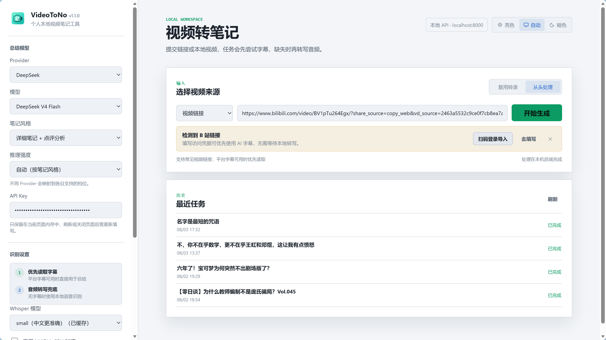

<p align="center">
  
</p>
<h1 align="center">AINote</h1>

<p align="center"><em>把视频变成笔记，再让笔记长出新的想法</em></p>

<p align="center">🌐 <a href="README.md">简体中文</a> · <a href="README_EN.md">English</a></p>

<p align="center"><a href="LICENSE"></a>&nbsp;&nbsp;&nbsp;</p>

> 本地优先的「视频 → 结构化笔记 → Obsidian 知识库」服务。
> 在 [like-attract/video-to-note](https://github.com/like-attract/video-to-note)（VideoToNo v1.4.5）基础上二创，
> 主打 **🌱 发芽 / ⚔️ 拷问 / 🎯 自测** 三种「思考模式」与 **Obsidian 双向链接集成**。

把 B 站 / 抖音 / 本地视频转成带时间轴的笔记只是起点。AINote 关心的是**笔记之后发生了什么**：
让笔记长出新的认知（发芽）、被质疑（拷问）、被真正记住（自测），并自动落进你的 Obsidian 库里，
用双向链接把原笔记与思考产物连成一张网。

---

## 🆚 与上游 VideoToNo 的区别

AINote 不是简单换皮，主要差异如下（均为本项目新增/改写）：

| 功能 | 说明 |
|---|---|
| 🌱 **发芽** | 按「得到大脑」发芽模式实现：**种子 → 跨界碰撞 → 启发**。从整篇笔记提炼思想内核，跨领域寻找**结构同构**的类比，产出「新知卡片」 |
| ⚔️ **拷问** | 挑漏洞 + **强制给出替代方案**。识别逻辑谬误（幸存者偏差 / 以偏概全 / 相关性冒充因果等），**每条判断都附原片时间点定位**，批评可点击回原视频核对 |
| 🎯 **自测** | 把笔记变成能考自己的题，`<details>` 折叠答案，**答案里附原片定位**。补上「看完 → 有笔记 → 合上能答出来」的学习闭环 |
| 🧠 **整体发芽** | 勾选多篇历史笔记，**跨篇找出反复出现的那颗共同种子**再跨界。同一颗种子在多篇里重现，才是你真正关心的问题 |
| 🔗 **Obsidian 双链集成** | 思考产物落成独立 `.md` 写进你的知识库，并自动与原笔记**双向链接**（`[[原笔记]]` / `[[…· 发芽报告]]`），反向链接面板立即可见。幂等，不会重复追加 |
| ⏱️ **时间戳跳转链接** | 笔记里的 `[02:29-02:57]` 变成可点击链接，直接跳到视频对应位置。自动清掉分享追踪参数，代码块内的时间戳不会被误改 |
| 🎙️ **Groq 云端转写** | 新增 `backend/groq_asr.py`：用 Groq 的 whisper-large-v3 系列做云端转写，免本地模型下载，速度与识别率大幅优于 tiny 档 |
| 🗑️ **任务删除** | 支持单个 / 批量删除历史任务（含已完成）。**只删工作目录，知识库里已归档的笔记不受影响** |
| 📄 **历史任务分页** | 「加载更多」逐页展开，不再被硬编码的 20 条上限截断 |
| 🛡️ **本地安全加固** | ① Host 头校验（防 DNS rebinding）② `note_path` 收口到知识库目录（防任意文件写）③ 笔记原子写 + `.bak` 备份（防写坏唯一一份笔记）④ yt-dlp 版本上限 |

### 相对上游**移除**的部分

为保持轻量，本项目移除了上游的以下模块（相应说明也已从文档中清理）：

- `backend/mcp_server.py` —— MCP 接入
- `backend/update_check.py` —— 检查更新
- `backend/douyin_login.py` —— 抖音登录（抖音抓取因平台风控已停用）
- 系统托盘驻留

---

## 🖼️ 界面预览



---

## 🚀 安装与启动

### 环境要求

- Python **3.10+**（开发验证于 3.12）
- 无需手动安装 FFmpeg：音视频解码走 PyAV，模型下载走 HuggingFace

### 快速开始

```bash
git clone https://github.com/qiyu166/AINote.git
cd AINote

python -m venv .venv
source .venv/bin/activate        # Windows: .venv\Scripts\activate

pip install -r backend/requirements.txt

cp .env.example .env             # 可选：配置归档目录
python launcher.py
```

启动后浏览器会自动打开 `http://127.0.0.1:8000`。

---

## ⚙️ 配置

编辑项目根目录的 `.env`（该文件已被 `.gitignore` 排除，不会提交）：

| 变量 | 说明 | 默认 |
|---|---|---|
| `HOST` | 监听地址，**请保持 127.0.0.1** | `127.0.0.1` |
| `PORT` | 端口 | `8000` |
| `MAX_UPLOAD_MB` | 本地上传大小上限 | `2048` |
| `MAX_CONCURRENT_TASKS` | 同时处理的任务数 | `1` |
| `TASK_HISTORY_LIMIT` | 保留的历史任务数 | `100` |
| `NOTES_OUTPUT_DIR` | **成品归档目录**（指向你的 Obsidian 库） | 空（用 `workspace/notes/`） |
| `VIDEOTONOTES_WORKSPACE` | 工作目录 | 项目内 `workspace/` |

### 接入 Obsidian（推荐）

```env
NOTES_OUTPUT_DIR=/Users/你的用户名/Documents/ObsidianVault
```

设好之后：

1. 笔记归档到该目录，并把截图复制到 `<笔记名>.assets/`，改写为相对引用 —— **知识库自包含**，删掉工作目录或换机器都不丢图
2. 点「🌱 思考」生成发芽/拷问/自测产物，**直接写进知识库**，并与原笔记互建双链
3. 打开原笔记 → 右侧「反向链接」面板 → 就能看到那份思考产物

### 配置模型

在界面左侧「模型配置」填入 API Key。支持 DeepSeek、OpenAI、Groq、通义千问、智谱、Moonshot 及任意兼容 OpenAI 协议的网关。

- 点击「保存到本机」后由后端统一保管，按**接口地址**存 Key（换成别的网关不会误发）
- 使用 Groq 转写需单独配置 Groq Key

> **密钥存储说明（诚实版）**：Windows 下用 DPAPI 加密；**macOS / Linux 下为明文回退**，仅靠文件权限（`0600`）保护。
> 接口 `/api/health` 的 `llm_key_storage` 字段会如实返回当前是加密还是明文。

---

## 🔁 处理流程

```
视频链接 / 本地文件
      ↓
获取信息 → 平台字幕 / 本地转写（Whisper、Paraformer 或 Groq 云端）
      ↓
时间轴对齐 → 截图提取（可选）
      ↓
LLM 生成结构化笔记
      ↓
时间戳转可跳转链接 → 归档到知识库
      ↓
        ┌───────────────┴───────────────┐
        ↓                               ↓
   🌱 思考三模式                    手动回顾
   （发芽 / 拷问 / 自测）
        ↓
  写进 Obsidian + 双向链接
```

---

## 🌍 支持范围

| 来源 | 平台字幕 | 本地转写 | 截图 |
|---|---|---|---|
| B 站（含分 P） | ✅ | ✅ | ✅ |
| 本地视频 / 音频 | — | ✅ | ✅ |
| YouTube 等 yt-dlp 支持站点 | 视站点而定 | ✅ | ✅ |
| 抖音 | ❌ 已停用（需浏览器上下文，风控成本高于收益） | ✅ 请先保存到本地再上传 | ✅ |

---

## ❓ 常见问题

**为什么要 B 站 Cookie？**
B 站对部分接口有风控（如视频页返回 412）。扫码登录后可显著提高取信息与字幕的成功率。Cookie 通过独立的浏览器实例（CDP）获取，用同一套信封加密保存。

**思考产物会不会覆盖我的笔记？**
不会。发芽/拷问/自测都是**独立文件**（`<笔记名> · 发芽报告.md` 等）。原笔记只在末尾**追加一行双链**，且写前会留 `.bak`、写时用「临时文件 + 原子替换」，不会写坏。

**重复发芽会不会堆一堆文件？**
不会。同一篇笔记反复发芽**覆盖同一份**报告；整体发芽按「选中的笔记」定文件名，也不会因模型措辞变化而堆积。

**删除任务会删掉 Obsidian 里的笔记吗？**
不会。删除只清理工作目录（音频、转录、截图）。知识库里的笔记是副本，不受影响。

**没有字幕时会发生什么？**
自动回退到本地转写（或你选择的 Groq 云端转写）。

**首次转写为什么等待很久？**
首次使用 Whisper 需下载模型（small 约 500MB，large-v3 约 3GB）。选用 Groq 云端转写可跳过此步。

**大模型报 400 `unsupported_parameter`？**
部分网关不接受 `thinking` / `reasoning_effort` 参数，程序会自动降级重试；持续报错请在模型配置页关闭深度思考。

---

## 🧪 开发

```bash
pip install -r backend/requirements-dev.txt
python -m pytest tests/ -q
```

当前测试：**358 passed / 2 skipped**。

### 项目结构

```
backend/
  main.py            FastAPI 应用：路由、任务流水线、归档、安全中间件
  llm_summarizer.py  LLM 调用与各模式 prompt（发芽/拷问/自测/整体发芽）
  groq_asr.py        Groq 云端转写（二创新增）
  whisper_asr.py     本地 faster-whisper
  paraformer_asr.py  sherpa-onnx 中文转写
  video_processor.py yt-dlp 下载、字幕、截图
  config_store.py    本机配置与密钥保管
  secret_box.py      密钥静态加密（DPAPI / 明文回退）
frontend/            原生 JS 单页界面
tests/               pytest 测试
```

---

## 📄 开源许可

本项目基于 **[like-attract/video-to-note](https://github.com/like-attract/video-to-note)**（VideoToNo v1.4.5）二次创作，
遵循原项目的 **MIT License**。

```
Copyright (c) 2026 like-attract (VideoToNo 原作者，上游项目 video-to-note)
Copyright (c) 2026 qiyu166 (AINote 二创部分)
```

MIT 许可允许自由使用、修改、分发与商用，**条件是保留上述版权声明与许可声明**。
完整条款见 [LICENSE](LICENSE)。

### 致谢

- 上游项目：[like-attract/video-to-note](https://github.com/like-attract/video-to-note) —— 提供了扎实的本地优先架构、转写链路与笔记生成能力，AINote 的全部基础能力来自这里
- 「发芽 / 拷问 / 点评 / 创作 / 回顾」的方法论参考了 **得到大脑** 的发芽模式与 ClawHub 上的「得到大脑会员式思考技能包」（MIT-0）

> AINote 与上述项目无隶属关系，为独立二创版本。问题反馈请提到 [本仓库 Issues](https://github.com/qiyu166/AINote/issues)。
